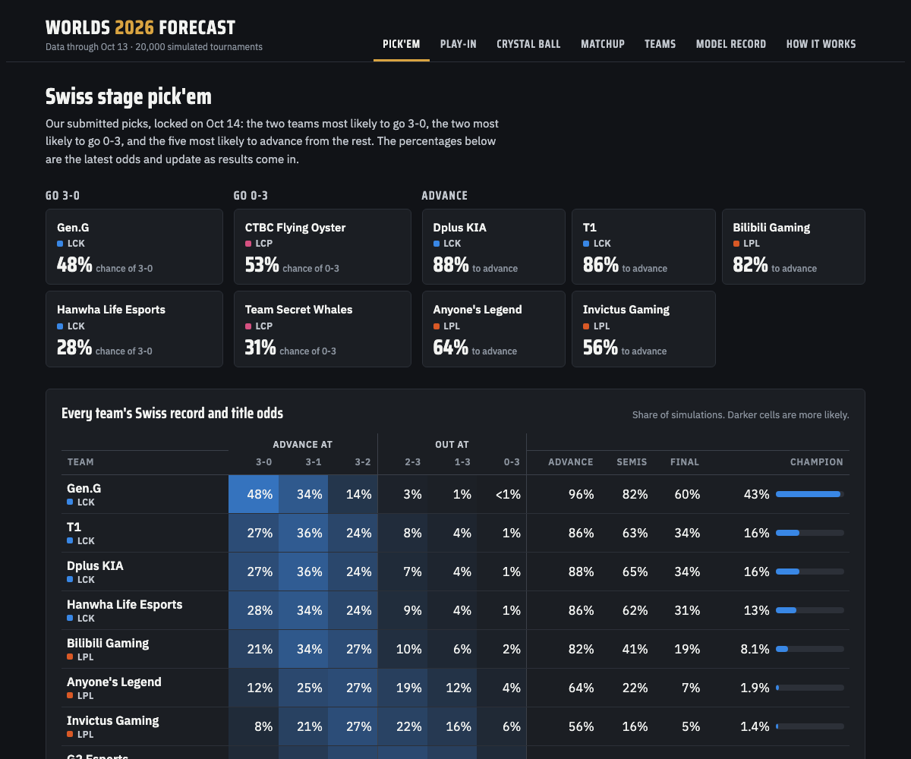
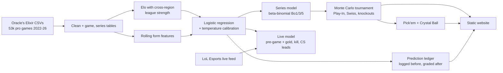
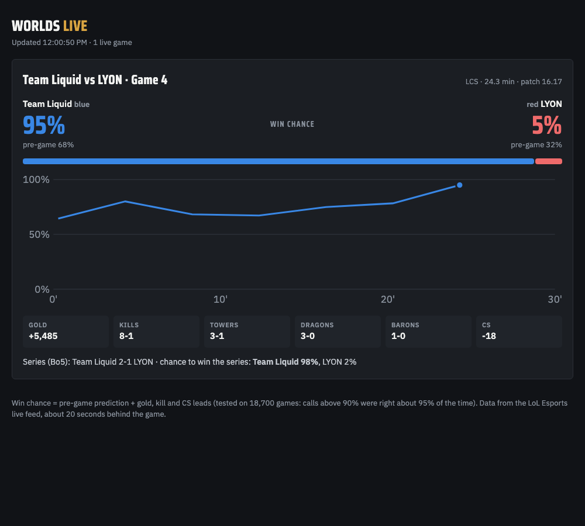

# Worlds 2026 Forecast

A League of Legends pro-match prediction system built for the 2026 World Championship. It covers:
- calibrated win probabilities for every game and series
- a full tournament simulator for pick'em
- live in-game win probabilities from the official broadcast's stats feed, computed in the visitor's browser
- a public ledger where every 2026 prediction is committed **before** the match and graded after

**Site:** https://kmunoz2022.github.io/worlds-2026-forecast/ (the Today tab shows the live game during matches)



## Results

All numbers are **out-of-sample**: each prediction comes from a model trained only on games played before it (monthly walk-forward retraining).

**Pre-game, Worlds 2022–2025** (430 games):

| Model | Accuracy | Log loss | Brier |
|---|---|---|---|
| **This model** | **66.0%** | **0.608** | **0.211** |
| "Stronger region" rule | 65.6% | 0.614 | 0.213 |
| Elo with cross-region linking | 62.8% | 0.622 | 0.217 |
| Coin flip | 54.9% | 0.693 | 0.250 |

On all 4,226 cross-region games since 2023: **69.5% accuracy / 0.590 log loss**, vs 64.8% / 0.627 for the region rule.

**Calibration.** When the model gives the favourite 60–65%, that team wins 63.6% of the time. Every probability band is within a few points.

**Why not higher pre-game?** For calibrated probabilities, expected accuracy equals the average favourite's probability, which is 66.1% for these Worlds games; the model scored 66.0%. Raising it takes new information, which is what the live model adds.

**Live in-game** (18.7k games from 2025–26, trained on 2022–24):

| Game minute | Accuracy | Games with a ≥90% call | Those calls correct |
|---|---|---|---|
| 10 | 71.6% | 10% | 96.1% |
| 15 | 75.4% | 24% | 94.8% |
| 20 | 79.7% | 38% | 95.4% |
| 25 | 83.8% | 48% | 96.6% |

**Worlds 2026:** graded live in [`ledger/predictions.jsonl`](ledger/predictions.jsonl) as the tournament is played.

## How it works



- **Cross-region strength.** Teams rarely play other regions, so a team's strength is its own Elo rating plus a league offset. International games move the offsets, and only games between major regions can move a major region. (A relegation series once inflated a whole region by 200 points; see [Bugs I found](docs/DECISIONS.md#bugs-i-found-and-fixed).)
- **Game model.** Logistic regression on the Elo parts, each region's international record and exponentially weighted form. International games are weighted 5× because Worlds is all international. Temperature scaling is fit on earlier out-of-sample international predictions. Gradient boosting was tested and didn't beat it.
- **Series.** Games in a series aren't independent: sweeps happen 65% of the time in Bo3s, vs 55% if games were independent coin flips. A beta-binomial model with κ fitted on 11k series reproduces real score distributions while keeping single-game odds unchanged.
- **Tournament.** 20,000 simulations of the Play-In (double elimination), Swiss (Bo1/Bo3, same-record pairing) and knockouts give advancement odds and pick'em choices.
- **Live.** The model combines the pre-game log-odds with gold, kill and CS leads, each scaled by game time. Series odds update after every game.
- **No leakage.** Every feature uses only earlier games. Splits are strictly by time. Worlds results were never used for tuning or model choice.



## Engineering decisions

[`docs/DECISIONS.md`](docs/DECISIONS.md) explains what I chose, why, and what I rejected, plus a table of the bugs I found and how I fixed them. Some highlights:
- Why the goal is calibration (log loss, Brier) rather than 95% pre-game accuracy, and how I measured the pre-game ceiling
- Why "international" means the two teams' home leagues differ, not the league label (regional qualifiers are filed as Worlds)
- Why logistic regression beat gradient boosting, and the rule for switching models
- How a relegation series moved the whole LCS rating, and the fix
- Why the champion-meta forecasts were backtested and published as long shots
- Live feed quirks: no game clock, final frames returned for past timestamps, mid-game gaps

## Project layout

```
src/lolpred/        library: data, elo, features, series, tournament, predict, live, ledger, ...
scripts/            pipeline steps and tools (refresh.py runs the whole chain)
config/             Worlds 2026 field, seeds, bracket; results as they happen
models/             saved model parameters
ledger/             locked picks and the append-only 2026 prediction ledger
site/               static website (index.html + data.json) and the local live page
docs/               decision log, result tables, screenshots
```

## Running it

```bash
python3 -m venv .venv && .venv/bin/pip install -r requirements.txt
# Download the yearly CSVs from Oracle's Elixir into Data/
.venv/bin/python scripts/refresh.py          # rebuild data, ratings, model, simulation, site data
.venv/bin/python scripts/ledger.py add "Gen.G" "T1" --bo 5 --stage "Final"   # log a prediction
.venv/bin/python scripts/live.py             # terminal/local version of the live predictions (the site runs them in the browser)
.venv/bin/python scripts/live.py --replay <match id>   # replay a finished match
```

Test the site's live view on a finished match: open `site/index.html?match=<match id>&at=<ISO time>#today` through a local web server.

The live feed needs the public API key that lolesports.com uses (listed in the [community API docs](https://vickz84259.github.io/lolesports-api-docs/)). Set `LOLESPORTS_API_KEY` or add `{"lolesports_api_key": "..."}` to `config/local.json`, which git ignores.

**Stack:** Python 3.13, pandas, NumPy, scikit-learn, Parquet. The website is plain HTML/CSS/JavaScript with hand-drawn SVG charts and no framework, deployed to GitHub Pages by GitHub Actions. The live view needs that same public key in the browser; it's the key lolesports.com's own site sends from every visitor's browser, so it isn't a secret.

## Credits

- Match data: [Oracle's Elixir](https://oracleselixir.com) (Tim Sevenhuysen).
- Live data: the unofficial LoL Esports API.
- This project isn't affiliated with or endorsed by Riot Games.
